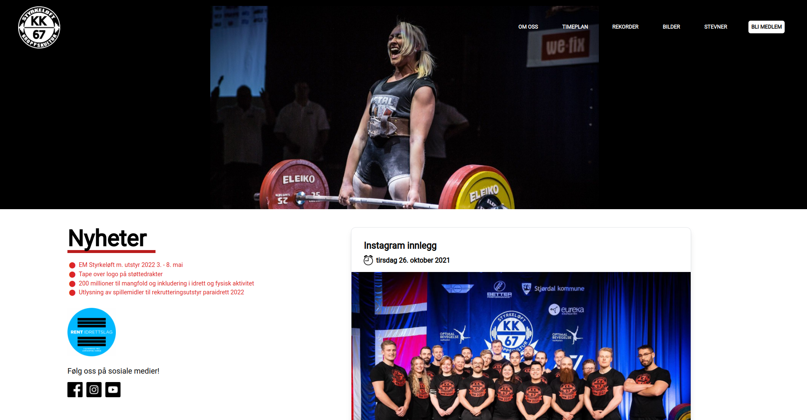
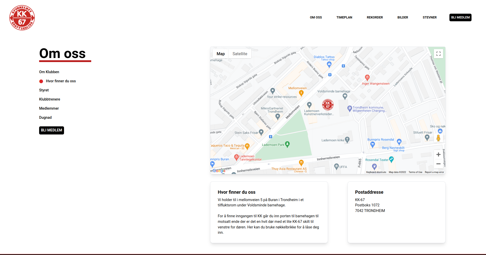
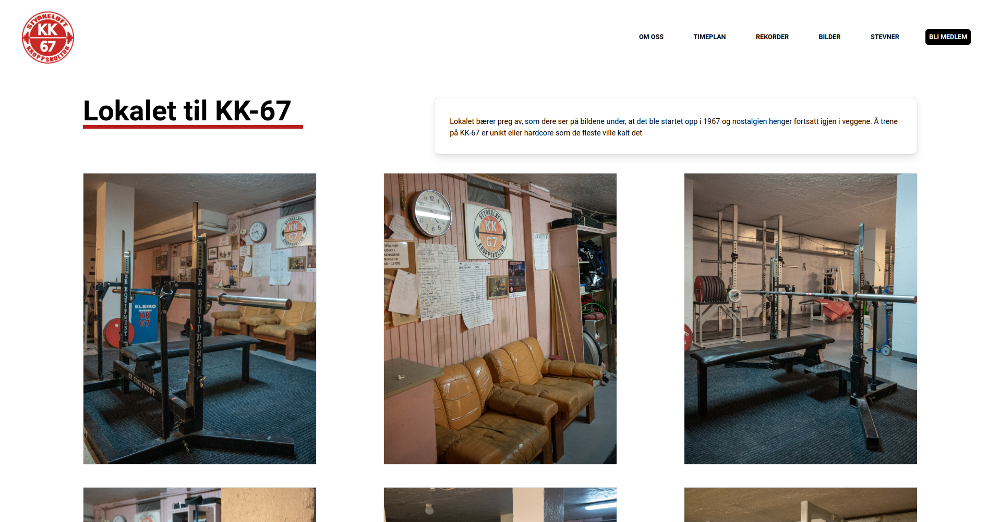

# KK67 - Website

This is the source code for the KK-67 website (currently in development).

<br >


## Website Concept:

A concept draft has been approved by KK-67 leader, **Jostein Fiveltun**.

Our aim is to develop a website that matches the concept draft provided [**here**](./design/)







<br >

# Get started

## Recommended IDE Setup

- [VSCode](https://code.visualstudio.com/) + [Volar](https://marketplace.visualstudio.com/items?itemName=johnsoncodehk.volar)

## Contribute

This website is maintained by [**Marius Arhaug**](https://www.github.com/MariusArhaug).

To contribute to this project, follow the guidelines described in the [CONTRIBUTING.md](./CONTRIBUTING.md)

## Production CI

GitHub Actions on Ubuntu runs uploader regressions, `yarn test` and `yarn build`
on pull requests to `master`. The Node.js test runner discovers application tests
when present; this deployment change does not add application features or their tests.
After a merge or push to `master`, CI also uploads the build using this repository's
`scripts\upload-frontend.ps1` and `scripts\ftps.psm1`. It checks out only this
repository, with no Docker-repository checkout or deployment controller pin.
Pull requests never upload files or receive production FTP credentials or the
Google Maps key.

Configure these repository secrets under **Settings > Secrets and variables >
Actions**: `FTP_USERNAME`, `FTP_PASSWORD`, and `VITE_GOOGLE_API_KEY`. Missing
production secrets stop deployment. Do not commit a `.env` file.

The destination is `ftp.c9ry3m6by.service.one`, directory `webroots/r1058728`.
Deployments run one at a time; a newer merge does not cancel an active upload.
The uploader never deletes remote files, preserving server routing configuration
and separately uploaded media. Uploads are not atomic and have no automatic rollback.

Uploader regressions run with Python 3 and PowerShell 7:

```powershell
python -m unittest discover -s tests -p "test_*.py"
```

### Local FTPS deployment

Use PowerShell 7 on Windows or Linux, Node.js 20.12 or newer, Yarn, and native
`curl` with FTPS support. To choose between installations, put the intended
executable's directory first on `PATH`.

From this repository, preview without connecting or reading credentials:

```powershell
pwsh -File .\scripts\upload-frontend.ps1 -WhatIf
```

Remove `-WhatIf` to build and upload, or add `-SkipBuild` to reuse `dist`.
An explicit `-Credential` takes precedence. Otherwise, the uploader reads
`FTP_USERNAME` and `FTP_PASSWORD` from this repository's ignored `.env`, then
prompts securely if both are absent. A partial pair fails before connecting.
Never prefix FTP secrets with `VITE_`.

To keep credentials in a separate private file, including an existing
Docker-root `.env`, pass `-EnvFilePath` to that file. No password copy is needed.
An explicitly selected missing file fails unless `-Credential` is supplied.
`-WhatIf` never reads that file or connects. Local saved passwords remain
plaintext; keep the file private and outside build output.

## Available Scripts

In the project directory, you can run:

```sh
$ yarn install
```

Installs the nessesary dependencies defined in [package.json](package.json)

```sh
$ yarn dev
```

Runs the app in the development mode.\
Open [**http://localhost:3000**](http://localhost:3000) to view it in the browser.

The page will reload if you make edits.\
You will also see any lint errors in the console.

```sh
$ yarn dev:host
```

Runs the app in development mode and also hosts the localhost to your local network. Allowing you to view the website from other computers or even phones! The terminal will provide ip addresses for you to use.

<br >

```sh
$ yarn build
```

Transpile `TypeScript` into `JavaScript` and check for build errors.

```sh
yarn preview
```

Previews the built package as if it were to be deployed.
